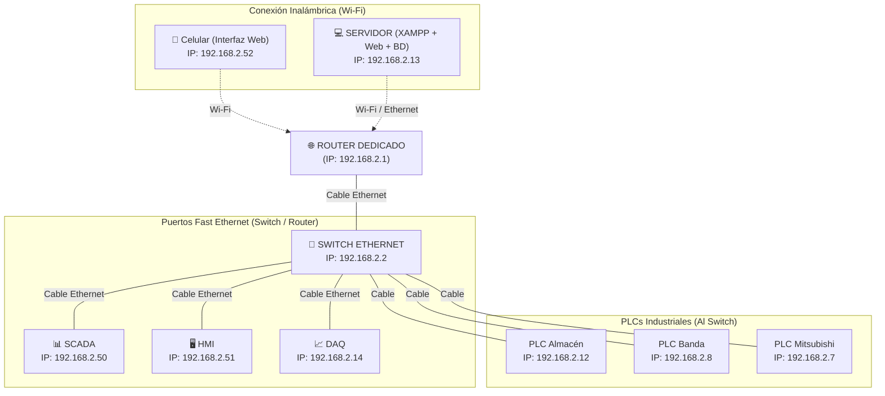

# 🌐 Guía Definitiva de Conexión en Red Local (A Prueba de Fallas)
### Proyecto: Click-Go (Router, Switch, PLCs, XAMPP, SCADA, Raspberry y Celular)

> [!IMPORTANT]
> **Sin Nube ni Internet:** Todo este sistema funciona **100% en red local cerrada**. No se requiere internet, ni saldo en el teléfono, ni conexión a Render o TiDB.

---

## 📑 Índice
1. [Conceptos Básicos (Para entender qué estamos haciendo)](#1-conceptos-básicos)
2. [Conexión Física de Cables (Dónde conectar cada cosa)](#2-conexión-física-de-cables)
3. [Direcciones IP (La regla de oro para que todo se hable)](#3-direcciones-ip)
4. [Configuración del Router](#4-configuración-del-router)
5. [Configuración de la Computadora (XAMPP + Node/Vite)](#5-configuración-de-la-computadora)
6. [Configuración del Celular (Wi-Fi)](#6-configuración-del-celular)
7. [Configuración de Raspberry, Servidor de Datos y SCADA](#7-configuración-de-raspberry-servidor-de-datos-y-scada)
8. [Checklist de Pruebas de 5 Minutos](#8-checklist-de-pruebas-de-5-minutos)
9. [Resolución de Dudas y Preguntas Frecuentes (FAQ)](#9-resolución-de-dudas-y-preguntas-frecuentes-faq)

---

## 1. Conceptos Básicos

- **El Router:** Es el "cerebro" de la red. Asigna direcciones IP por Wi-Fi al celular y comunica a todos los equipos entre sí.
- **El Switch:** Es un "multicontacto" de red Ethernet. Si el router no tiene suficientes puertos, el switch te da más puertos. Todo lo conectado al switch está conectado al router automáticamente.
- **La Computadora con XAMPP:** Es el servidor central. Aloja la base de datos MySQL local y corre el programa de la página web (React + Express).
- **El Celular:** Es el control remoto. Se conecta por Wi-Fi a la página web alojada en la computadora para que el usuario elija su pieza.
- **Los PLCs (Almacén, Banda, Mitsubishi):** Son los controladores industriales que mueven los motores y pistones reales. Tienen una IP fija asignada.

---

## 2. Conexión Física de Cables

### Diagrama de Conexiones



### Reglas para conectar los cables:
1. **NO USAR EL PUERTO WAN / INTERNET DEL ROUTER:**
   - Los routers tienen un puerto de color diferente (azul o amarillo) que dice *WAN* o *Internet*. **Déjalo vacío**.
   - Usa exclusivamente los puertos que dicen **LAN 1, LAN 2, LAN 3, LAN 4**.
2. **Conexión Router -> Switch:**
   - Toma un cable Ethernet cualquiera. Conecta un extremo a cualquier puerto **LAN** del Router y el otro extremo a cualquier puerto del **Switch**.
3. **Conexión de los PLCs y SCADA:**
   - Conecta los cables Ethernet de los PLCs (Almacén, Banda, Mitsubishi), SCADA, HMI y DAQ directamente al **Switch**.
4. **Verificación visual:**
   - Al conectar cada cable, el foquito LED del puerto en el router/switch **debe encender en verde o naranja y parpadear**. Si está apagado, el cable no sirve o el equipo está apagado.

---

## 3. Direcciones IP Oficiales del Laboratorio

Todos los dispositivos están en la subred `192.168.2.XXX` con máscara `255.255.255.0` y Gateway `192.168.2.1`:

| Componente | Dirección IP | Dirección MAC | Interfaz | Rol / Función |
| :--- | :--- | :--- | :--- | :--- |
| **Router** | `192.168.2.1` | `24:F5:A2:E9:DD:C1` | Fast Ethernet | Gateway y Punto de Acceso Wi-Fi |
| **Switch** | `192.168.2.2` | `00:1E:C1:01:33:E0` | Fast Ethernet | Concentrador de red para PLCs y SCADA |
| **PLC Banda** | `192.168.2.8` | `00:1B:1B:70:71:A7` | Fast Ethernet | Controlador principal estación Banda |
| **PLC Mitsu** | `192.168.2.7` | `28:63:36:81:E2:DC` | Fast Ethernet | Controlador principal robot Mitsubishi |
| **PLC Almacén** | `192.168.2.12` | `28:63:36:80:A7:A3` | Fast Ethernet | Controlador principal estación Almacén |
| **SCADA** | `192.168.2.50` | `40:C2:BA:C1:70:76` | Fast Ethernet | Lee pedidos y actualiza Estados en MySQL |
| **HMI** | `192.168.2.51` | `00:1C:06:18:18:F7` | Fast Ethernet | Interfaz de operación local |
| **Celular** | `192.168.2.52` | `C4:77:64:5A:DA:92` | Wireless | Interfaz web del usuario (`:5173`) |
| **Servidor (Compu)**| `192.168.2.13` | `80:E4:BA:F7:C8:30` | Wireless / Eth | Aloja XAMPP (MySQL) y Servidor Web |
| **DAQ** | `192.168.2.14` | `22:C5:58:B3:DA:40` | Fast Ethernet | Adquisición de datos |

> [!CAUTION]
> ### ⚠️ ALERTA CRÍTICA: ¿Qué pasa si los PLCs ya tienen otra IP grabada?
> Los PLCs casi nunca tienen DHCP; traen una IP fija que les grabó el profesor o el equipo de automatización.
> - Si tus PLCs tienen, por ejemplo, `192.168.0.10`, `192.168.0.20`, etc.
> - **TODO TU SISTEMA DEBE CAMBIAR AL RANGO `192.168.0.XXX`:**
>   - Router: `192.168.0.1`
>   - Compu: `192.168.0.50`
>   - Celular: recibirá `192.168.0.100+`
> 
> *Los primeros 3 números (`192.168.X.`) deben coincidir en TODOS los aparatos sin excepción.*

---

## 4. Configuración del Router

Si el router es nuevo o se va a resetear:
1. Conecta la compu por cable al router o a su Wi-Fi.
2. Abre el navegador web y ve a `http://192.168.1.1` (o la IP que indique la etiqueta debajo del router).
3. Entra con el usuario y contraseña de fábrica (suele ser `admin` / `admin` o venir en la etiqueta).
4. **Configurar la LAN:**
   - Ve a **Network** -> **LAN**.
   - IP Address: `192.168.1.1` (o `192.168.0.1` según los PLCs).
   - Subnet Mask: `255.255.255.0`.
5. **Configurar el DHCP Server:**
   - Habilita el servidor DHCP.
   - Rango de IPs (IP Pool): `192.168.1.100` a `192.168.1.200`. (Esto asegura que el router no le dé la IP de la compu ni de los PLCs al celular).
6. **Configurar el Wi-Fi:**
   - Nombre de red (SSID): Ponle un nombre claro (ej. `ClickGo-Lab`).
   - Contraseña: Algo fácil de escribir en el celular (ej. `clickgo2026`).

---

## 5. Configuración de la Computadora

### Paso 5.1: Poner IP fija en Windows o Linux
Para que el Servidor siempre tenga la IP `192.168.2.13` fija:
1. **En Windows:**
   - Presiona `Tecla Windows + R`, escribe `ncpa.cpl` y presiona **Enter**.
   - Clic derecho sobre tu adaptador (Ethernet o Wi-Fi) -> **Propiedades**.
   - Doble clic en **Protocolo de Internet versión 4 (TCP/IPv4)**.
   - Selecciona *"Usar la siguiente dirección IP"*:
     - **Dirección IP:** `192.168.2.13`
     - **Máscara de subred:** `255.255.255.0`
     - **Puerta de enlace predeterminada:** `192.168.2.1`
     - DNS: Déjalo en blanco o pon `192.168.2.1`.
   - Clic en **Aceptar**.
2. **En Linux:**
   - Configuración de Red -> IPv4 -> Manual:
     - **Address:** `192.168.2.13`
     - **Netmask:** `255.255.255.0`
     - **Gateway:** `192.168.2.1`

---

### Paso 5.2: Iniciar XAMPP (Apache + MySQL)
1. Abre **XAMPP Control Panel** (de preferencia como Administrador).
2. Haz clic en **Start** en **Apache** y en **MySQL**.
3. Ambos deben ponerse en verde.
4. Abre tu navegador en la compu e ingresa a `http://localhost/phpmyadmin`.
5. Verifica que exista la base de datos `clickgo`. Si no está:
   - Crea una BD llamada `clickgo`.
   - Clic en la pestaña **Importar** y selecciona el archivo `database.sql` de la carpeta del proyecto.

---

### Paso 5.3: Configurar el archivo `.env` del Proyecto
En la carpeta raíz del proyecto (`Dani`), verifica o crea el archivo `.env`:
```env
PORT=3001
DB_HOST=127.0.0.1
DB_PORT=3306
DB_USER=root
DB_PASSWORD=
DB_NAME=clickgo
DB_SSL=false
```

---

### Paso 5.4: DESACTIVAR EL FIREWALL DE WINDOWS (¡MUY IMPORTANTE!)
> [!WARNING]
> En el 95% de los proyectos universitarios, el celular no se conecta a la compu porque **el Firewall de Windows bloquea las conexiones entrantes**.
> 
> **Cómo resolverlo para la presentación:**
> 1. Presiona `Tecla Windows`, escribe **Firewall de Windows Defender** y ábrelo.
> 2. En el menú izquierdo da clic en: **Activar o desactivar Firewall de Windows Defender**.
> 3. Marca la opción **Desactivar Firewall de Windows Defender** en *Configuración de red privada*.
> 4. Da clic en **Aceptar**. (Al terminar tu presentación mañana lo puedes volver a encender).

---

### Paso 5.5: Iniciar el servidor web para la Red Local
En la terminal del Servidor, dentro de la carpeta del proyecto, ejecuta:
```bash
npm run dev
```
Verás un letrero como este:
```
  VITE v5.x.x  ready in 250 ms

  ➜  Local:   http://localhost:5173/
  ➜  Network: http://192.168.2.13:5173/
```
> La dirección **Network: `http://192.168.2.13:5173/`** es la que usará el celular.  
> **NO CIERRES ESTA TERMINAL.**

---

## 6. Configuración del Celular (`192.168.2.52`)

1. Enciende el Wi-Fi de tu celular y conéctate a la red del router del laboratorio.
2. **APAGA LOS DATOS MÓVILES (4G / 5G):**
   > [!IMPORTANT]
   > Como el router del laboratorio no tiene internet, los teléfonos Android e iPhone detectan *"Wi-Fi sin conexión a internet"*. Si tus datos móviles están prendidos, el teléfono desvía la navegación a datos celulares y nunca encontrará la compu. **Apagando los datos móviles obligas al celular a buscar en la red local**.
3. Si el celular te muestra una notificación que dice *"Esta red no tiene acceso a internet, ¿deseas permanecer conectado?"*, selecciona **SÍ / MANTENER CONEXIÓN**.
4. Abre Chrome o Safari e ingresa a:
   ```
   http://192.168.2.13:5173
   ```
5. ¡Listo! Verás la aplicación de Click-Go con las 3 cajas actualizadas (**Arte**, **Electrónica** y **Juguetes**).

---

## 7. Configuración de SCADA (`192.168.2.50`)

SCADA es el encargado de leer los pedidos nuevos y coordinar a los PLCs:

### 1. Conexión de SCADA a la base de datos MySQL de XAMPP:
- **Host / IP:** `192.168.2.13`
- **Puerto:** `3306`
- **Usuario:** `root`
- **Contraseña:** *(vacía)*
- **Base de Datos:** `clickgo`

> [!TIP]
> **Permiso en phpMyAdmin:** Para que MySQL acepte la conexión remota desde el SCADA (`192.168.2.50`), entra en el Servidor a `http://localhost/phpmyadmin`, pestaña **SQL** y corre:
> ```sql
> GRANT ALL PRIVILEGES ON clickgo.* TO 'root'@'%' IDENTIFIED BY '';
> FLUSH PRIVILEGES;
> ```

### 2. Flujo de SCADA con las tablas de MySQL:
- **1. Detectar nuevo pedido:**
  ```sql
  SELECT ID_pedido, ID_categoria FROM pedido_historico WHERE en_espera = 1 ORDER BY ID_pedido DESC LIMIT 1;
  ```
  *(Categorías: 1 = Electrónica, 2 = Arte, 3 = Juguetes)*
- **2. Reportar progreso de estaciones:**
  - Almacén termina: `UPDATE Estado SET almacen = 2 WHERE ID_estado = 1;`
  - Banda termina: `UPDATE Estado SET banda = 2 WHERE ID_estado = 1;`
  - Mitsubishi termina: `UPDATE Estado SET mitsubishi = 2 WHERE ID_estado = 1;`
  - Lugar de entrega termina: `UPDATE Estado SET lugar_entrega = 2 WHERE ID_estado = 1;`
- **3. Marcar pedido completado:**
  ```sql
  UPDATE pedido_historico SET en_espera = 0 WHERE ID_pedido = [ID_DEL_PEDIDO];
  ```

### 3. IPs de los PLCs que controla SCADA:
- **PLC Almacén:** `192.168.2.12`
- **PLC Banda:** `192.168.2.8`
- **PLC Mitsubishi:** `192.168.2.7`

---

## 8. Checklist de Pruebas de 5 Minutos (Antes de la Demo)

Haz esta prueba en orden estricto antes de que lleguen los profesores o evaluadores:

- [ ] **1. Foquitos de red:** Revisa que Router y Switch tengan foquitos verdes parpadeando en cada cable conectado.
- [ ] **2. Ping a los PLCs y SCADA:** En la compu abre la terminal y corre:
  ```bash
  ping 192.168.2.12
  ping 192.168.2.8
  ping 192.168.2.7
  ping 192.168.2.50
  ```
  *Si responde "<1ms", los equipos están vivos y comunicados.*
- [ ] **3. XAMPP Verde:** Apache y MySQL en verde.
- [ ] **4. Terminal corriendo:** `npm run dev` activa y mostrando `Network: http://192.168.2.13:5173/`.
- [ ] **5. Celular listo:** Conectado al Wi-Fi del router, **datos móviles apagados**, navegador abierto en `http://192.168.2.13:5173`.
- [ ] **6. Pedido de prueba:**
  - Elige una pieza (ej. Acuarela en Arte) y presiona "Sí".
  - En phpMyAdmin en la compu, entra a la tabla `pedido_historico` y verifica que haya aparecido el nuevo renglón con `en_espera = 1`.
  - Verifica que en la tabla `Estado` las estaciones hayan cambiado a `1` (En Proceso).

---

## 9. Resolución de Dudas y Preguntas Frecuentes (FAQ)

#### P1: "¿Necesitamos conectar un cable con internet de la universidad o de la casa al router?"
**R:** **NO.** El router funciona como un switch/puente local. No necesita salida a internet para conectar el celular, la compu y los PLCs.

#### P2: "¿El router tiene que ser de alguna marca especial?"
**R:** No, cualquier router sirve (TP-Link, Mercusys, Cisco, D-Link, Huawei, o los módems viejos de Telmex/Totalplay).

#### P3: "¿Qué pasa si me quedo sin puertos libres en el router?"
**R:** Conecta los cables sobrantes al **Switch**. El Switch y los puertos LAN del router son la misma red. Da exactamente igual si conectas la Raspberry al Switch o al Router.

#### P4: "En el celular pongo `http://192.168.1.50:5173` y dice 'No se puede acceder a este sitio web' (ERR_CONNECTION_TIMED_OUT)"
**R:** Revisa en este orden:
1. ¿Apagaste los datos móviles del celular? (Casi siempre es esto).
2. ¿Desactivaste el Firewall de Windows en la computadora? (Si no lo desactivaste, Windows bloquea al celular).
3. ¿Corriste el comando con `--host 0.0.0.0`? Si solo pusiste `npm run dev`, no aceptará conexiones externas.
4. ¿El celular está conectado al Wi-Fi correcto del router?

#### P5: "El navegador del celular me cambia automáticamente a `https://192.168.1.50:5173` y da error de SSL"
**R:** Borra el `https://` y escribe manualmente `http://192.168.1.50:5173`. En red local no se usa certificado SSL `https`.

#### P6: "Hago ping al PLC (`ping 192.168.1.10`) y dice 'Host de destino inaccesible' o 'Tiempo de espera agotado'"
**R:**
1. Revisa que el cable del PLC esté bien enchufado en el switch y la luz del puerto esté prendida.
2. Verifica qué IP tiene configurada el PLC en su software (GX Works / TIA Portal). Si el PLC tiene `192.168.0.10`, tu compu tiene que cambiarse a `192.168.0.50` para poder hablarle.

#### P7: "En la terminal de la compu sale error `ECONNREFUSED 127.0.0.1:3306`"
**R:** Significa que MySQL está apagado. Abre XAMPP y presiona "Start" en MySQL.

#### P8: "¿Se puede conectar la computadora al router por Wi-Fi en lugar de cable Ethernet?"
**R:** Sí, pero por cable Ethernet la conexión es 100 veces más estable y evita retrasos con los PLCs. Si conectas la compu por Wi-Fi, la IP fija `192.168.1.50` se debe configurar en el adaptador Wi-Fi de Windows, no en el Ethernet.
